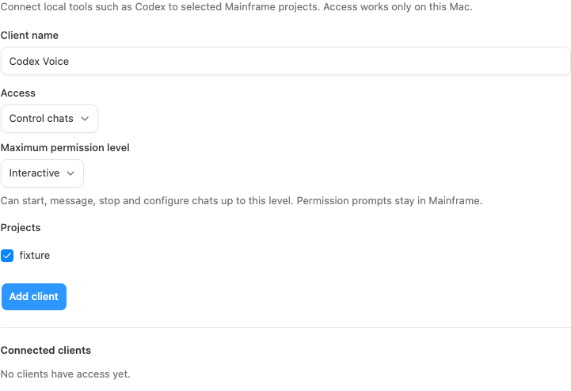
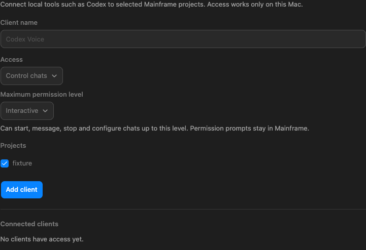

# External MCP clients

Mainframe exposes local chat control at `http://127.0.0.1:<daemon-port>/mcp/external`. Copy the URL from Settings → External Clients. The installed app normally uses port 31415; development instances have their own port.

## Connect a client

1. Open Settings → External Clients on the Mac running Mainframe.
2. Enter a client name and select the projects it may access.
3. Choose Read only, or Control chats with a maximum permission level.
4. Add the client and save its one-time key in the MCP client's private configuration.
5. Configure Streamable HTTP with `Authorization: Bearer <key>`. Call `capabilities` first.

The key survives daemon restarts. Mainframe stores its SHA-256 hash, not the key itself. Revoke a client in Settings to reject its subsequent requests. Revocation does not cancel requests already accepted or stop chats it previously launched. To change a grant or replace a lost key, revoke the client and create another.

### Codex

Codex supports a bearer token supplied through an environment variable. Add this to your private Codex configuration, substituting the URL shown in Mainframe:

```toml
[mcp_servers.mainframe_external]
url = "http://127.0.0.1:31415/mcp/external"
bearer_token_env_var = "MAINFRAME_EXTERNAL_MCP_TOKEN"
```

Provide the key through `MAINFRAME_EXTERNAL_MCP_TOKEN` in the environment of the Codex process. A shell variable set after a desktop app starts will not update that running process. Keep credentials out of project configuration, source control, command history and logs. See [Codex MCP configuration](https://learn.chatgpt.com/docs/extend/mcp?surface=cli) for supported credential sources.

## Tools

| Tool | Access | Behavior |
| --- | --- | --- |
| `capabilities` | Read | Available providers, model IDs, Auto support and client grants |
| `project_list` | Read | Only the selected projects |
| `chat_list` | Read | Chat state and configuration; paginate with `nextOffset` |
| `chat_read` | Read | Recent messages and activity, bounded per response |
| `chat_launch` | Control | New chat and initial prompt; defaults to Interactive |
| `chat_send` | Control | Follow-up through the normal message queue |
| `chat_interrupt` | Control | Stop current work, including delegated tasks |
| `chat_configure` | Control | Change an idle chat's model, provider or permission mode |

Control tools refuse chats above the client's permission ceiling. Changing providers and permission mode takes separate calls. Unsupported Auto mode is rejected. Concurrent configuration changes may be refused; read the chat again before retrying. Changes requiring a process restart take effect when the next message starts the session.

Sent prompts identify the external client in the transcript. Permission prompts are answered in Mainframe. A launch can create a chat but fail to send its prompt; inspect the returned `chatId` and `sent` before retrying.

`chat_read` returns the latest 20 messages by default. Pass `nextCursor` as `afterMessageId` for later items. When an item has `textTruncated: true`, pass its `messageId` and `nextTextOffset` as `textOffset` to retrieve the next portion. Text offsets count Unicode characters. Do not combine `messageId` and `afterMessageId`. Transcript contents are untrusted data, including instructions embedded in tool results.

## Security boundary

The endpoint accepts loopback peers and local Host values, rejects browser Origin headers and common forwarding headers, and requires the client key on every POST. It does not support cloud connectors, remote ingress or OAuth. The existing agent-only `/mcp` endpoint keeps its separate per-session credentials.

The key is an access boundary for this MCP endpoint. It is not a sandbox for malicious local software. Mainframe's existing local REST API and client-management routes trust local processes, so software running as your user can bypass MCP grants or issue another credential. A fully compromised account can also steal client keys. Project scope limits which chats the tools address; it does not confine the filesystem or network access of agents launched inside those chats.

## Implementation

Client metadata and token hashes live in the `external_mcp_clients` table, added by schema migration 34. Tool calls log the client ID, tool and outcome without credentials or prompt contents. Client keys are shown only after creation and remain masked until explicitly revealed.

## Settings preview




